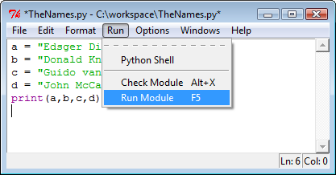

I am Pablo Gallardo, a cybersecurity and IT professional with more than 16 years of experience.

You can find more information about me on my personal website:

<https://pmgallardo.com>

**RunModule** is my personal digital garden, a project that started in 2010 as a place to collect, organize, and share useful technical knowledge, valuable findings, and repeatable procedures.

It has evolved into a knowledge base covering different areas of IT and cybersecurity, with two main types of content:

- **References**: Wiki-style entries that introduce to technical subjects, technologies, tools, and ideas.
- **Guides**: Practical, step-by-step articles that show how to accomplish specific tasks, solve problems, or implement repeatable procedures.

Like any digital garden, this site is a work in progress. Articles may evolve over time as I learn new things, revisit existing knowledge, and discover better ways of doing things.

The name RunModule was inspired by an option in IDLE, the default integrated development environment (IDE) for the Python programming language.

I hope you find something useful here. If you have questions, suggestions, or simply want to share your thoughts, feel free to get in touch. I always enjoy hearing from people who find value in this project.

Enjoy your visit!
